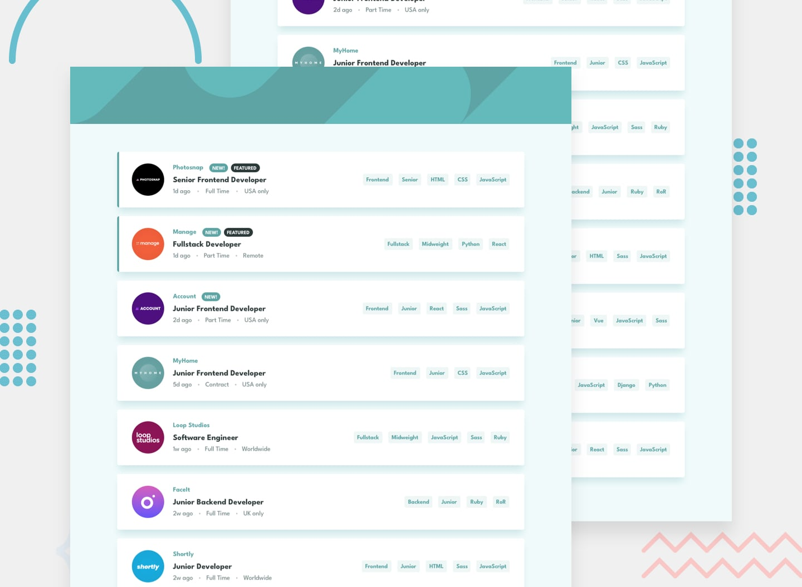

# Frontend Mentor - Job listings with filtering solution


This is a complete solution to the [Job listings with filtering challenge on Frontend Mentor](https://www.frontendmentor.io/challenges/job-listings-with-filtering-ivstIPCt). This project demonstrates responsive web design, dynamic content rendering, and interactive filtering functionality using vanilla HTML, CSS, and JavaScript


## Overview

### The challenge

Users should be able to:

- ✅ View the optimal layout for the site depending on their device's screen size
- ✅ See hover states for all interactive elements on the page
- ✅ Filter job listings based on the categories (role, level, languages, tools)
- ✅ Add multiple filters simultaneously
- ✅ Remove individual filters or clear all filters at once



### Features

🎨 **Responsive Design**
- Mobile-first approach (375px to 1440px+)
- Adaptive layouts for different screen sizes
- Touch-friendly interface on mobile devices

🔍 **Advanced Filtering**
- Filter by Role (Frontend, Backend, Fullstack)
- Filter by Level (Junior, Midweight, Senior)
- Filter by Languages (HTML, CSS, JavaScript, Python, Ruby)
- Filter by Tools (React, Sass, Vue, Django, RoR)
- Multiple active filters with AND logic
- Visual filter management with removal options

💼 **Job Listings**
- 10 complete job listings with real company data
- Company logos and branding
- "New!" and "Featured" badges
- Detailed job information (location, contract type, posting date)

## Technical Implementation

### Built with

- **HTML5** - Semantic markup with accessibility in mind
- **CSS3** - Modern styling with Flexbox and CSS Grid
- **JavaScript ES6+** - Vanilla JS with modern features
- **Google Fonts** - League Spartan typography
- **Mobile-first** - Responsive design approach
- **JSON** - Dynamic data loading with fallback support

### Project structure

```
static-job-listings-master/
├── index.html          # Main application file
├── styles.css          # Complete styling (347 lines)
├── script.js           # JavaScript functionality (324 lines)
├── test.html           # Testing interface
├── data.json           # Job listings data
├── images/             # Company logos and assets
│   ├── bg-header-desktop.svg
│   ├── bg-header-mobile.svg
│   ├── icon-remove.svg
│   └── [company-logos].svg
└── design/             # Reference designs
    ├── desktop-design.jpg
    ├── mobile-design.jpg
    └── mobile-with-filters.jpg
```

### Key features

🔧 **Dynamic Content Rendering**
```js
// Creates job cards from data
function createJobCard(job) {
  const jobCard = document.createElement('div');
  jobCard.className = `job-card ${job.featured ? 'featured' : ''}`;
  // Dynamic HTML generation with proper data attributes
}
```

🎯 **Smart Filtering System**
```js
// Multi-filter logic with AND operation
function filterJobs() {
  const filteredJobs = jobsData.filter(job => {
    const jobTags = [job.role, job.level, ...job.languages, ...job.tools]
      .map(tag => tag.toLowerCase());
    return activeFilters.every(filter => jobTags.includes(filter));
  });
}
```

📱 **Responsive CSS Architecture**
```css
/* Mobile-first approach */
.job-card { /* Mobile styles */ }

@media (max-width: 768px) {
  .job-card {
    flex-direction: column;
    /* Mobile-specific adjustments */
  }
}
```

## Getting Started

### Installation

1. **Download or clone** this repository
2. **No build process required** - pure HTML/CSS/JS
3. **No dependencies** - everything included

### Usage

**Option 1: Direct File Opening**
```bash
# Simply open in your browser
open index.html
# or double-click the file
```

**Option 2: Local Server (Recommended)**
```bash
# Using Python
python -m http.server 8000

# Using Node.js
npx http-server

# Then visit: http://localhost:8000
```

**Option 3: Testing Interface**
```bash
# Open the comprehensive test page
open test.html
```

## Development Process

### What I learned

This project enhanced my skills in:

1. **🎨 CSS Architecture** - Organized, maintainable stylesheets with proper naming conventions
2. **⚡ JavaScript Patterns** - Event delegation, async/await, error handling
3. **📱 Responsive Design** - Mobile-first approach with multiple breakpoints
4. **🔍 Algorithm Design** - Efficient filtering with multiple criteria
5. **♿ Accessibility** - Semantic HTML and keyboard navigation support

### Challenges faced

**🚫 CORS Restrictions**
- **Problem:** JSON loading failed when opening files directly
- **Solution:** Implemented comprehensive fallback data system

**📐 Layout Complexity**
- **Problem:** Different layouts for mobile vs desktop
- **Solution:** CSS Grid and Flexbox with strategic media queries

**🎯 Filter State Management**
- **Problem:** Managing multiple active filters efficiently
- **Solution:** Array-based state with functional programming patterns

### Future improvements

**Phase 1: Enhanced UX**
- ✨ Smooth animations for filter transitions
- 🔍 Search functionality with autocomplete
- 💾 LocalStorage for filter persistence
- ⌨️ Full keyboard navigation support

**Phase 2: Advanced Features**
- 📊 Sort options (date, company, salary)
- 🏷️ Filter categories with counts
- 📱 Progressive Web App (PWA) features
- 🌙 Dark mode toggle

**Phase 3: Performance**
- 🚀 Virtual scrolling for large datasets
- 📦 Code splitting and lazy loading
- 🗜️ Image optimization and lazy loading


## Author

- Frontend Mentor - [@Ayokanmi-Adejola](https://www.frontendmentor.io/profile/Ayokanmi-Adejola)
